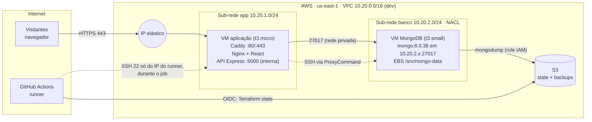
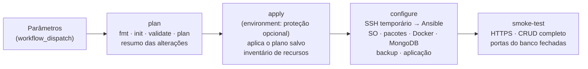
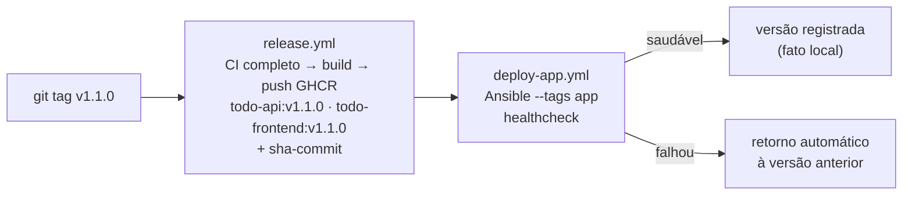

# Arquitetura · ToDo App na AWS

**Equipe:** Pedro Henrique Majewski e Gabriel Marrone de Lima
**Demanda:** [escopo do ToDo App para a Feira de Profissões](escopo.md) · **Entrega:** PM-04 (Terraform + Ansible + CI/CD)

## 1. Análise da demanda

O cliente (alunos do 3º período) tem uma aplicação que roda localmente em Docker Compose e precisa publicá-la na internet para a feira. Os pontos principais da demanda:

| Necessidade | Origem | Como foi atendida |
|---|---|---|
| Aplicação e MongoDB em VMs distintas, banco em VM exclusiva | REQ-01, seção 2 | Duas EC2: `*-app-*` e `*-db-*` |
| Banco acessível somente pela API, pela rede privada | REQ-02 | SG do banco aceita 27017 apenas do SG da aplicação; porta publicada só no IP privado; NACL bloqueia 27017 vindo de fora da VPC |
| Administração restrita, credencial própria da aplicação, segredos fora do código e dos logs | REQ-03 | SSH fechado (aberto só para o runner durante o job); OIDC sem chaves fixas; usuários do Mongo com privilégio mínimo; GitHub Secrets + `no_log` |
| Armazenamento persistente, backup e restauração testada; atualização não apaga dados | REQ-04 | Volume EBS separado; `mongodump` agendado para o S3; teste de restauração em container isolado; backup automático antes de trocar a versão do banco |
| URL HTTPS utilizável em outro dispositivo, frontend e API no mesmo endereço | REQ-05 | Caddy com Let's Encrypt em `<ip>.sslip.io` (ou domínio próprio); Nginx encaminha `/todos` à API |
| Reinício dos serviços, verificações de saúde (incluindo API → banco) e diagnóstico | REQ-06 | `restart: unless-stopped`; HEALTHCHECK em todos os containers; `/health` testa o MongoDB; pipeline de operações (status/logs/restart) |
| Pipelines de infraestrutura e de entrega da aplicação | Seções 7 a 9 | `infra.yml`, `ops.yml`, `ci.yml`, `release.yml`, `deploy-app.yml` |
| Custos mensais e do período | Seção 12 | [custos.md](custos.md) |

Componentes e dependências: **navegador → Caddy (TLS) → Nginx (React + proxy) → API Express → MongoDB**. A API depende do banco, o que o healthcheck e a reconexão automática tratam. O frontend depende da API apenas em tempo de requisição, porque o Nginx resolve o nome da API dinamicamente. O backup depende do S3 e da role IAM da VM.

## 2. Diagramas

### 2.1 Infraestrutura

### 2.2 Pipeline principal (`infra.yml`, action=apply)

### 2.3 Entrega da aplicação

## 3. Decisões técnicas

| # | Decisão | Alternativas consideradas | Justificativa |
|---|---|---|---|
| D1 | **AWS**, região **us-east-1** | Azure for Students, GCP, sa-east-1 | Conta Free Tier disponível (créditos de US$ 100 a 200); provedor Terraform maduro; OIDC com GitHub; us-east-1 é a região mais barata, e a latência a partir do Brasil (~130 ms) é irrelevante para uma lista de tarefas |
| D2 | **2 EC2 Ubuntu 24.04**: app `t3.micro`, banco `t3.small` | VM única; RDS/DocumentDB; Kubernetes | Atende a arquitetura mínima com o menor custo. O MongoDB precisa de ~2 GiB (cache do WiredTiger + sistema). A app (Nginx estático + Node + Caddy) cabe em 1 GiB com swap. Serviços gerenciados fogem do escopo (MongoDB em VM) e Kubernetes seria complexo demais para os alunos |
| D3 | Tipos restritos a t3.micro, t3.small, c7i-flex.large, m7i-flex.large | Qualquer tipo | Únicos tipos x86 elegíveis ao plano gratuito para contas novas; a validação evita erro na criação |
| D4 | VM do banco com IP público **apenas para saída**, sem regra de entrada da internet | NAT Gateway; sub-rede privada com a VM da app como NAT | O NAT Gateway custa US$ 0,045/h (~US$ 33/mês), mais que as duas VMs juntas. A NAT na VM da app adiciona complexidade e um ponto de falha. Com SG + NACL + porta publicada só no IP privado, o banco não é alcançável pela internet (comprovado no teste de fumaça) |
| D5 | **IP elástico** na VM da aplicação | IP automático | O endereço (e o nome `sslip.io`) não muda ao redimensionar ou reiniciar a VM |
| D6 | **HTTPS com Caddy + Let's Encrypt** em `<ip>.sslip.io`; parâmetro `domain_name` para domínio próprio | ALB + ACM; Nginx + certbot; Cloudflare | Gratuito e sem domínio comprado; o certificado é emitido e renovado sozinho; o ALB custaria mais que as VMs |
| D7 | Docker em cada VM, containers gerenciados pelo Ansible (`community.docker`) | Docker Compose nas VMs | O Ansible compara o estado desejado com o real (idempotência), recria só o que mudou e permite o retorno automático de versão |
| D8 | Imagens no **GHCR** com tag explícita `vX.Y.Z` + `sha-<commit>` | Docker Hub; ECR; `latest` | Integrado ao GitHub (token temporário da própria pipeline, sem segredo extra); versões identificáveis e reprodutíveis, como recomenda o PM-04 |
| D9 | **Terraform State no S3** (versionado, criptografado, lock nativo `use_lockfile`), um arquivo por ambiente | Terraform Cloud; state local | Persistência e recuperação de versões anteriores; lock sem DynamoDB; sem dependência de outro serviço |
| D10 | **OIDC** GitHub → AWS, role restrita ao repositório | Access keys em Secrets | Nenhuma chave de longa duração; credenciais expiram ao fim do job |
| D11 | **SSH fechado por padrão**; a pipeline abre a porta 22 só para o IP do runner durante o job e fecha no final; banco acessado via ProxyCommand pela VM da app | SSM Session Manager; SSH aberto ao mundo | Administração restrita (REQ-03) sem a complexidade do SSM; as regras temporárias são recursos fora do Terraform (não geram diferença no plan) |
| D12 | Volume **EBS separado** para os dados; `ignore_changes = [ami]` | Dados no disco da VM | Recriar ou redimensionar a VM não apaga as tarefas; nova versão da imagem Ubuntu não recria a VM |
| D13 | **Backup**: `mongodump` 2x/dia (systemd timer) → S3 com retenção de 14 dias, metadados (quantidade de tarefas, sha256); backup automático antes de trocar a versão do MongoDB, de restaurar e de limpar a lista | Snapshots EBS (DLM) | Restauração portátil e verificável; teste de restauração em container `--network none`, sem tocar a demonstração (ACE-07) |
| D14 | Atualizações automáticas do Ubuntu **desligadas**; o SO é atualizado pela pipeline (`update_os`) | unattended-upgrades | Mudanças controladas e auditáveis; evita conflito de `apt` durante as execuções |
| D15 | Pipelines separadas: `infra` (Terraform → Ansible → testes), `release`/`deploy-app` (entrega da aplicação) e `ops` (rotinas) | Uma pipeline única | Os alunos executam rotinas sem risco de alterar a infraestrutura; a concorrência é serializada por ambiente |

## 4. Rede e acessos

| Origem → Destino | Porta | Regra |
|---|---|---|
| Internet → VM app | 80, 443 | SG `app` (HTTP redireciona para HTTPS) |
| Runner do GitHub → VM app | 22 | Regra temporária `/32` criada e removida pela pipeline |
| `admin_cidrs` → VM app | 22 | Opcional, por parâmetro |
| VM app → VM banco | 27017, 22 | SG `db` referencia o SG `app` |
| Internet → VM banco | qualquer | **Nenhuma** regra no SG; NACL nega 27017 de fora da VPC |
| VM banco → S3 | 443 | Role IAM limitada a `s3://todo-app-backups-<conta>/<ambiente>/*` |

Credenciais:

| Credencial | Onde fica | Quem usa |
|---|---|---|
| Role AWS da pipeline | OIDC (sem segredo) | GitHub Actions |
| Chave SSH | Secret `SSH_PRIVATE_KEY` / `SSH_PUBLIC_KEY` | Ansible |
| Senhas do MongoDB (root, aplicação, backup) | Secrets do ambiente GitHub (`MONGO_*`) | Ansible → arquivos `0600`/`0400` nas VMs |
| Token do GHCR | `GITHUB_TOKEN` temporário; logout ao final | Ansible (pull das imagens) |

## 5. Persistência e recuperação

- **Dados:** `/srv/mongo-data` no volume EBS `*-mongo-data`, montado pelo ID do volume. O Ansible só formata o volume se ele estiver vazio. Recriar o container (`ops: restart recreate=true`) ou a VM mantém os dados.
- **Backups:** `todo-mongo-backup` gera `todo-<amb>-<data>-<motivo>.archive.gz` + `.json` (quantidade de tarefas, sha256, imagem) em `s3://todo-app-backups-<conta>/<amb>/`, com 3 cópias locais.
- **Teste de restauração:** `todo-mongo-restore-test` baixa o backup, confere o sha256, restaura em um container sem rede e compara a quantidade de tarefas.
- **Restauração real:** `ops: restore` faz antes um backup de segurança.
- **Terraform State:** versionado no S3. Para recuperar, restaure uma versão anterior do objeto `todo-app/<amb>/terraform.tfstate` pelo console do S3 (aba *Versões*). O lock (`.tflock`) impede execuções simultâneas.
- **Retorno de versão da aplicação:** é automático se a nova versão não ficar saudável. Manualmente, rode `deploy-app.yml` com a versão anterior (lista em *Releases*).

## 6. Limitações conhecidas

- **Disponibilidade:** há uma VM de cada tipo e uma zona de disponibilidade, sem alta disponibilidade. Uma falha da VM causa indisponibilidade até a recuperação. Isso é aceitável para um evento de um dia e está documentado no manual.
- **`sslip.io`** é um serviço público gratuito de DNS. Se estiver fora do ar, a URL deixa de resolver; o domínio próprio (`domain_name`) elimina essa dependência. O Let's Encrypt tem limite de emissões por domínio; o certificado fica guardado no volume do Caddy e só é reemitido se a VM for recriada.
- **Lista compartilhada:** não há login, e todos os visitantes veem e alteram a mesma lista (comportamento definido no escopo). A limpeza é intencional, pela rotina `reset-demo-list`.
- **Senha root do MongoDB:** só é aplicada na primeira inicialização do banco. As senhas da aplicação e do backup podem ser trocadas pela pipeline; trocar a do root exige procedimento manual.
- **Confiança na chave SSH:** a pipeline aceita a chave do host na primeira conexão (*trust on first use*) em cada execução.
- **Ambiente de validação:** o `terraform validate` e a primeira execução real acontecem no GitHub Actions. O código foi verificado localmente com ansible-lint (perfil production), actionlint, shellcheck, testes da aplicação e verificação de sintaxe e formatação do HCL.

## 7. Premissas (a confirmar com a organização da feira)

| Item | Premissa adotada |
|---|---|
| Data e duração da feira | A definir. Hipótese: 1 dia, janela de 8 h, com ensaio na véspera |
| Público simultâneo | Até ~50 visitantes simultâneos, com requisições leves (JSON de poucos KB) |
| Conta de nuvem | Conta AWS Free Tier da equipe (plano gratuito, créditos de US$ 100 a 200) |
| Domínio | Ainda não comprado; `sslip.io` até a compra (troca pelo parâmetro `domain_name`) |
| Dados | Somente dados de demonstração; sem dados pessoais |
